# Hotel Management System - Database Documentation

This document describes the Entity-Relationship (ER) model and schema design for the **Hotel Management System** DBMS coursework project.

## Entity Relationship Diagram

```mermaid
erDiagram
    %% Authentication & Staff Management
    Branch ||--o{ Staff : "employs"
    Staff ||--o| Receptionist : "is a"
    Staff ||--o| Manager : "is a"
    Staff ||--o| Therapist : "is a"

    Branch {
        VARCHAR(36) Branch_ID PK
        VARCHAR(100) Location_Name
        TEXT Address
        VARCHAR(100) Contact_Info
    }
    Staff {
        VARCHAR(36) Staff_ID PK
        VARCHAR(50) First_Name
        VARCHAR(50) Last_Name
        VARCHAR(100) Email UK
        VARCHAR(255) Password_Hash
        VARCHAR(50) Role
        VARCHAR(36) Branch_ID FK
    }
    Receptionist {
        VARCHAR(36) Staff_ID PK "FK to Staff"
        VARCHAR(50) Shift_Timing
        VARCHAR(20) Desk_Extension
    }
    Manager {
        VARCHAR(36) Staff_ID PK "FK to Staff"
        VARCHAR(100) Department_Managed
        VARCHAR(20) Office_Number
    }
    Therapist {
        VARCHAR(36) Therapist_ID PK
        VARCHAR(36) Staff_ID FK "UK"
        VARCHAR(100) Specialty
    }

    %% Property & Room Infrastructure
    Branch ||--o{ Rooms : "has"
    RoomType ||--o{ Rooms : "categorizes"
    RoomType ||--o{ PriceRule : "applies to"
    Rooms ||--o{ Room_Amenities : "features"

    RoomType {
        VARCHAR(36) RoomType_ID PK
        VARCHAR(100) Name
        INT Base_Capacity
        DECIMAL(10_2) Base_Price
    }
    Rooms {
        VARCHAR(36) Room_ID PK
        VARCHAR(20) Room_Number
        VARCHAR(36) Branch_ID FK
        VARCHAR(36) RoomType_ID FK
        VARCHAR(50) Housekeeping_Status
    }
    Room_Amenities {
        VARCHAR(36) Room_ID PK "FK to Rooms"
        VARCHAR(100) Amenity_Name PK
    }
    PriceRule {
        VARCHAR(36) Rule_ID PK
        VARCHAR(36) RoomType_ID FK
        DATE Start_Date
        DATE End_Date
        DECIMAL(5_2) Price_Multiplier
        VARCHAR(100) Rule_Name
    }

    %% CRM, Reservations & Operations
    Guest ||--o{ Reservations : "makes"
    Rooms ||--o{ Reservations : "reserved via"
    Rooms ||--o{ HousekeepingTask : "requires"
    Staff ||--o{ HousekeepingTask : "assigned to"

    Guest {
        VARCHAR(36) Guest_ID PK
        VARCHAR(50) First_Name
        VARCHAR(50) Last_Name
        VARCHAR(100) Email UK
        VARCHAR(20) Phone
        INT Loyalty_Points
        VARCHAR(50) Loyalty_Tier
        TEXT Special_Requests
    }
    Reservations {
        VARCHAR(36) Reservation_ID PK
        VARCHAR(36) Guest_ID FK
        VARCHAR(36) Room_ID FK
        DATE Check_In_Date
        DATE Check_Out_Date
        DATETIME Actual_Check_In
        DATETIME Actual_Check_Out
        VARCHAR(50) Booking_Status
    }
    HousekeepingTask {
        VARCHAR(36) Task_ID PK
        VARCHAR(36) Room_ID FK
        VARCHAR(36) Assigned_Staff_ID FK
        VARCHAR(50) Task_Type
        VARCHAR(50) Status
        DATE Reported_Date
    }

    %% On-Site Services & POS Integration
    Reservations ||--o{ FoodOrder : "places"
    FoodOrder ||--o{ FoodOrderItem : "contains"
    MenuItem ||--o{ FoodOrderItem : "is ordered as"
    Reservations ||--o{ SpaAppointment : "books"
    SpaService ||--o{ SpaAppointment : "provided in"
    Therapist ||--o{ SpaAppointment : "conducts"

    MealPlan {
        VARCHAR(36) Plan_ID PK
        VARCHAR(100) Plan_Name
        DECIMAL(10_2) Price_Per_Day
    }
    MenuItem {
        VARCHAR(36) Item_ID PK
        VARCHAR(100) Name
        TEXT Description
        VARCHAR(50) Category
        DECIMAL(10_2) Price
    }
    FoodOrder {
        VARCHAR(36) Order_ID PK
        VARCHAR(36) Reservation_ID FK
        DATETIME Order_Time
        DECIMAL(10_2) Total_Amount
        VARCHAR(50) Order_Status
    }
    FoodOrderItem {
        VARCHAR(36) Order_ID PK "FK to FoodOrder"
        VARCHAR(36) Item_ID PK "FK to MenuItem"
        INT Quantity
        DECIMAL(10_2) Subtotal_Price
    }
    SpaService {
        VARCHAR(36) Service_ID PK
        VARCHAR(100) Service_Name
        INT Duration_Minutes
        DECIMAL(10_2) Price
    }
    SpaAppointment {
        VARCHAR(36) Appointment_ID PK
        VARCHAR(36) Reservation_ID FK
        VARCHAR(36) Service_ID FK
        VARCHAR(36) Therapist_ID FK
        DATETIME Start_Time
        DATETIME End_Time
        VARCHAR(50) Status
    }

    %% Billing, Payments & Invoicing
    Reservations ||--o| Invoice : "generates"
    Invoice ||--o{ InvoiceItem : "contains"
    Reservations ||--o{ Payments : "pays for"
    Invoice ||--o{ Payments : "settles"

    Tax {
        VARCHAR(36) Tax_ID PK
        VARCHAR(100) Tax_Name
        DECIMAL(5_2) Percentage_Rate
    }
    Coupon {
        VARCHAR(50) Coupon_Code PK
        DECIMAL(5_2) Discount_Percentage
        DECIMAL(10_2) Max_Discount_Amount
        DATE Expiry_Date
    }
    Invoice {
        VARCHAR(36) Invoice_ID PK
        VARCHAR(36) Reservation_ID FK "UK"
        DATE Issue_Date
        DECIMAL(10_2) Total_Charges
        DECIMAL(10_2) Discount_Applied
        DECIMAL(10_2) Tax_Applied
        DECIMAL(10_2) Net_Payable
    }
    InvoiceItem {
        VARCHAR(36) InvoiceItem_ID PK
        VARCHAR(36) Invoice_ID FK
        TEXT Description
        VARCHAR(50) Charge_Category
        DECIMAL(10_2) Amount
    }
    Payments {
        VARCHAR(36) Payment_ID PK
        VARCHAR(36) Reservation_ID FK
        VARCHAR(36) Invoice_ID FK
        DECIMAL(10_2) Amount
        DATETIME Payment_Date
        VARCHAR(50) Method
        VARCHAR(50) Payment_Status
    }
```

<b>Click to expand Mermaid source code</b>

## Schema Overview

- **Authentication & Staff**:
  - `Branch`: Hotel physical branches.
  - `Staff`: Employee records with role-based attributes.
  - `Receptionist` & `Manager`: Specialization sub-tables extending `Staff` (1:1 relationship sharing primary key).
  - `Therapist`: Links to `Staff` (1:1) to identify staff capable of spa service delivery.

- **Rooms & Property**:
  - `RoomType`: Master definitions for categories, capacities, and base rates.
  - `Rooms`: Individual physical rooms linked to a branch and room type.
  - `Room_Amenities`: Composite key `(Room_ID, Amenity_Name)` modeling multivalued room amenities.
  - `PriceRule`: Dynamic seasonal or promotional pricing multipliers over specific date ranges.

- **Reservations & Operations**:
  - `Guest`: Guest profiles with contact info and loyalty tiers.
  - `Reservations`: Bookings connecting guests, specific rooms, schedules, and statuses.
  - `HousekeepingTask`: Maintenance and cleaning task tracking assigned to hotel staff.

- **On-Site Services & POS**:
  - `MealPlan`: Daily meal package configurations.
  - `MenuItem`: Restaurant menu items and unit prices.
  - `FoodOrder` & `FoodOrderItem`: Room service / restaurant order tracking billed to reservations.
  - `SpaService` & `SpaAppointment`: Spa bookings conducted by licensed therapists.

- **Billing, Invoicing & Payments**:
  - `Tax`: Tax categories and percentage rates.
  - `Coupon`: Promotional vouchers with validity dates and maximum caps.
  - `Invoice` & `InvoiceItem`: Line-item breakdown of all reservation charges (room, food, spa, penalties).
  - `Payments`: Multi-tender payment tracking settled against reservations and invoices.
